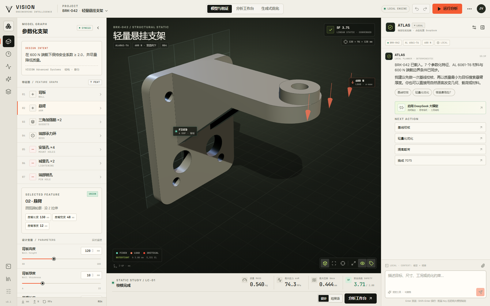
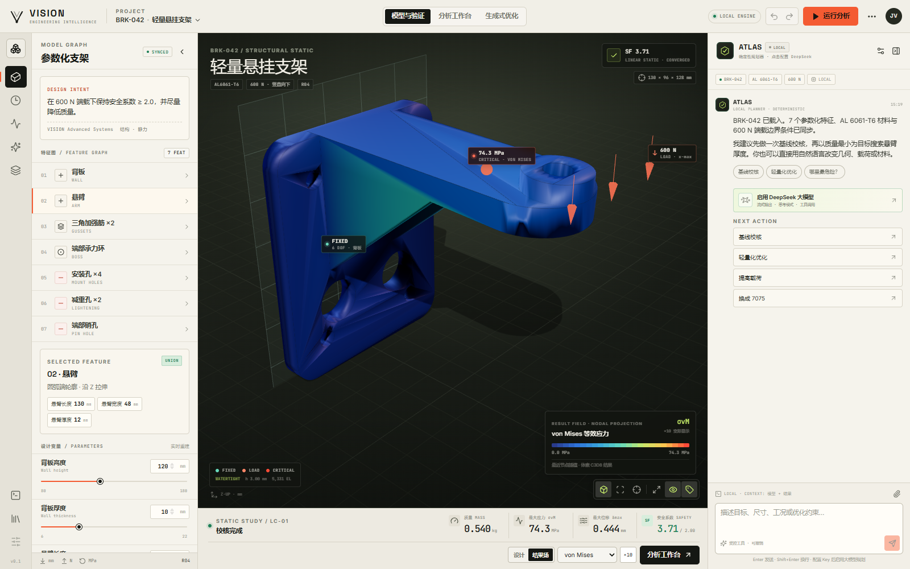
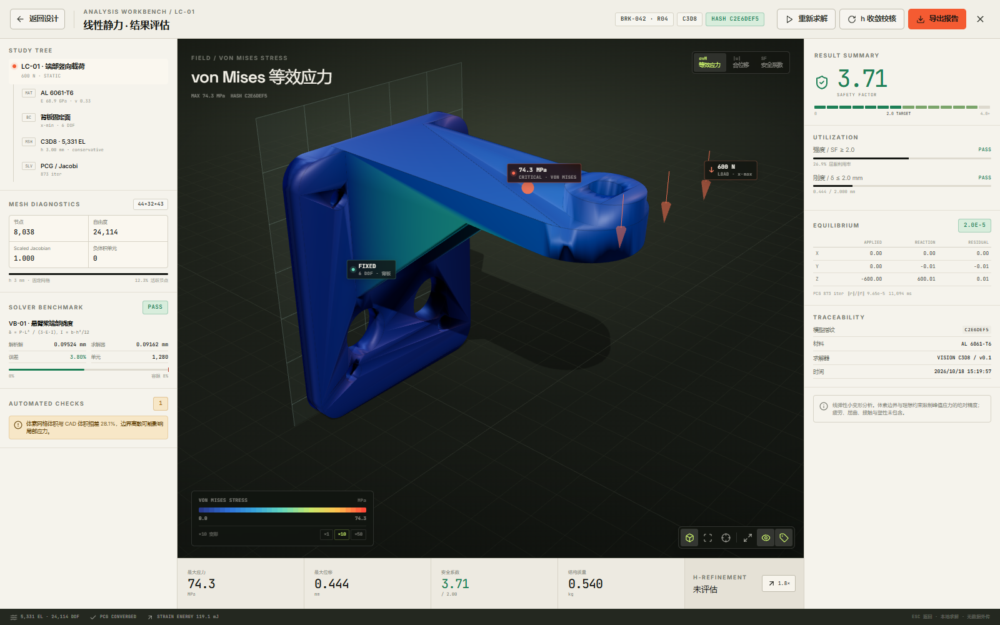
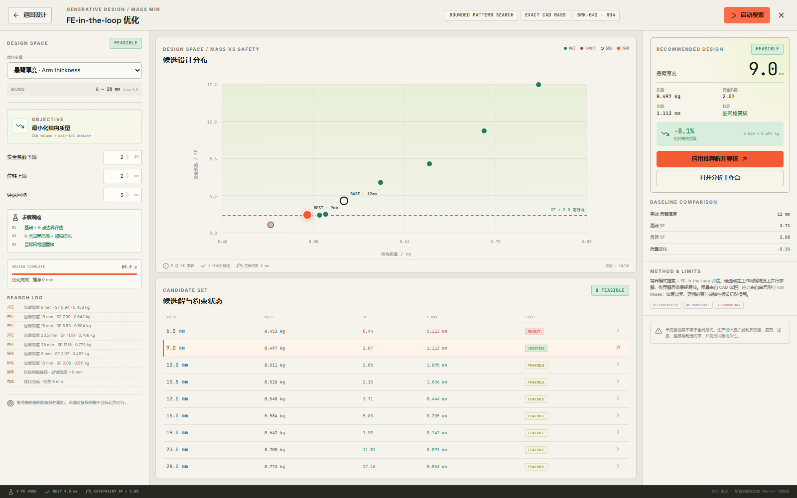
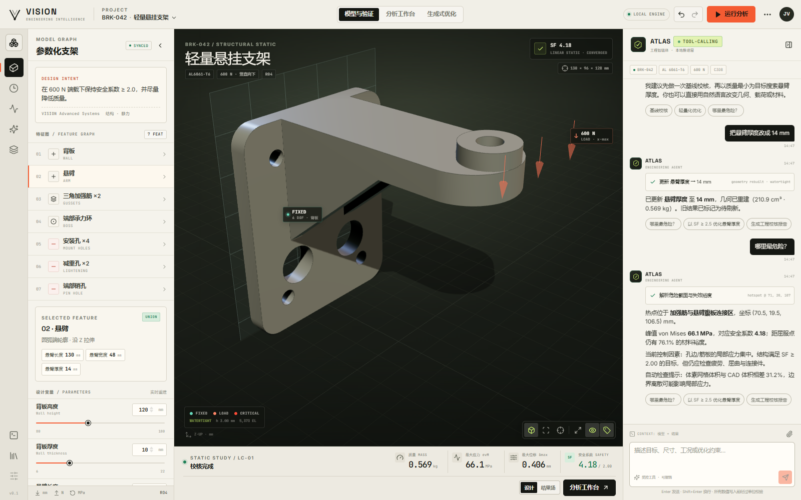
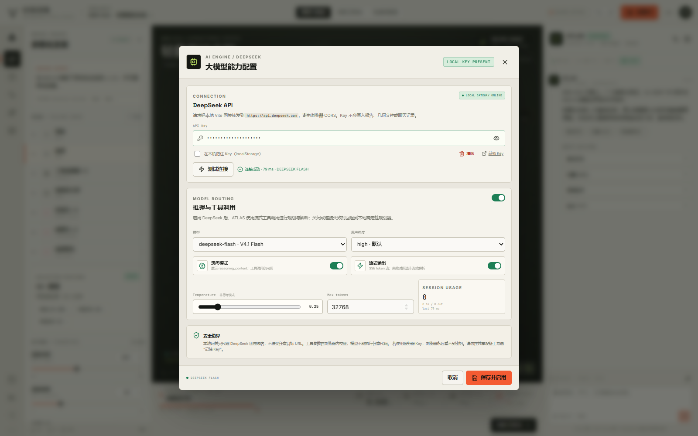
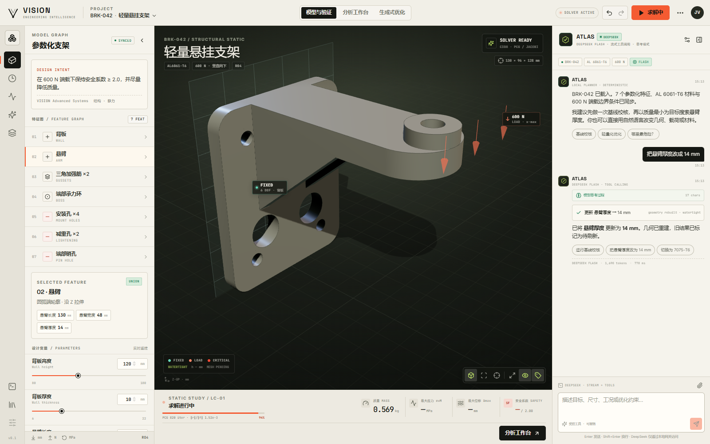

# VISION

**AI-native CAD / CAE engineering studio.**  
从一句工程意图，到参数化几何、体素有限元、可验证的校核结果，再到质量优化与可追溯报告。



> **Intent → Geometry → Evidence.**
> 不是给传统 CAD 加一个聊天框，而是把“设计意图、几何重建、仿真证据、优化决策”组织成一条可撤销、可复现、可审计的工具链。

---

## 1. 这是什么

VISION 是一个运行在浏览器里的 AI 原生工程工作台原型。它把自然语言作为第一等输入，把参数化特征、线弹性有限元、设计变量优化和工程报告串成闭环：

- **语言交互**：中文 / English 意图 → DeepSeek 流式工具调用，或本地确定性规划器回退；可改参数、换材料、加载荷、改约束、求解、优化、生成报告。
- **完整大模型能力**：`deepseek-flash` / `deepseek-v4-pro`、thinking 模式与 reasoning effort、SSE 流式输出、多轮工具调用、reasoning_content 回放、token usage、失败回退。
- **本地安全网关**：Vite 代理转发到 DeepSeek 固定域名，避免浏览器 CORS；支持浏览器会话 Key 或服务端 `DEEPSEEK_API_KEY` 注入。
- **参数化建模**：7 个特征、14 个设计变量，基于 Manifold 的 watertight mesh-boolean 内核实时重建。
- **真实 CAE**：C3D8 六面体网格、线弹性静力、矩阵自由 PCG + Jacobi，全部在浏览器 Worker 中运行。
- **工程证据**：解析基准验证、反力平衡、PCG 残差、网格质量、模型指纹、限制声明与 Markdown 报告。
- **FE-in-the-loop 优化**：并行 Worker 设计空间搜索，多候选细网格复核回退，输出最小质量可行解。
- **按需组件**：分析工作台、优化工作台、报告模块、求解 Worker 全部走独立 lazy chunk，首屏不加载重型工作区。
- **本地优先**：几何、FEA、优化、报告全部在浏览器内运行；唯一可选出站请求是经本地网关的 DeepSeek 对话，且不发送原始网格数组。打开页面即可运行。

当前示例项目：**BRK-042 · 轻量悬挂支架**。  
AL 6061-T6，600 N 端载，四螺栓背板固定，目标 **SF ≥ 2.0**。

---

## 2. 快速开始

要求 **Node.js ≥ 20.19**。

```bash
npm install
npm run dev
```

打开终端输出的地址（默认 `http://127.0.0.1:4173`）。

生产构建：

```bash
npm run build
npm run preview
```

验证：

```bash
npm test          # 7/7：几何 / 求解器 / 解析器 / DeepSeek 工具契约
npm run typecheck
```

可选浏览器验收（需要本机 Edge + `playwright-core`）：

```bash
node scripts/screenshot.mjs          # 工作台 / 结果场 / 分析工作台
node scripts/deepseek-mock-test.mjs  # 流式 reasoning + tool call + 工具结果回放
```

> 首次打开会自动执行一次基线校核。当前机器上的浏览器 Worker 完成 5k 级单元求解约 8–12 秒；期间界面会显示网格与 PCG 进度。若只想浏览设计，可等待“校核完成”后操作。

### 启用 DeepSeek 大模型

VISION 内嵌一个本地 Vite 网关，把 `/api/deepseek/*` 转发到 `https://api.deepseek.com`，避免浏览器直连的 CORS 问题。

**推荐：服务器端注入 Key（浏览器看不到密钥）**

```bash
# .env（不要提交到 git）
DEEPSEEK_API_KEY=sk-...
```

然后重启 `npm run dev` 或 `npm run preview`。应用会自动检测服务端 Key，ATLAS 头部显示 `DEEPSEEK`。

**浏览器端配置**

打开右侧 ATLAS 头部的 `LOCAL` / `DEEPSEEK` 状态或齿轮按钮，粘贴 API Key：

- 默认只保存在 `sessionStorage`，关闭标签页即失效；
- 勾选“在本机记住 Key”后才写入 `localStorage`；
- 共享设备不建议勾选；
- 配置页可测试连接、切换模型、调整 thinking / reasoning effort / streaming / temperature / max tokens。

`.env.example` 提供了模板。若在静态托管环境部署，需要自行提供等价的 `/api/deepseek/*` 反向代理；否则页面会检测到网关不可用并回退本地规划器。


---

## 3. 可以直接试的交互

在右侧 **ATLAS** 对话框输入：

| 意图 | 示例 |
|---|---|
| 改尺寸 | `把悬臂厚度改成 14 mm，然后重新校核` |
| 换材料 | `材料换成 7075-T6，保持当前载荷` |
| 改载荷 | `末端加载 1.2 kN 向下，然后校核` |
| 改约束 | `把约束改到底面` |
| 风险诊断 | `哪里最危险？` |
| 优化 | `以质量最小为目标，安全系数不低于 2.0，位移不超过 2.0 mm，优化悬臂厚度` |
| 报告 | `生成一份工程校核报告` |

也可以直接使用左侧参数滑杆、材料库、分析工作台和优化工作台。

### 已实现的工具调用

| Tool | 作用 |
|---|---|
| `set_variable` | 修改参数化设计变量并重建几何 |
| `set_material` | 切换线弹性材料并重算质量 |
| `set_load` | 更新合力、加载面与方向 |
| `set_support` | 更新 6-DOF 固定面 |
| `run_analysis` | 体素网格 + PCG 静力求解 |
| `optimize` | 启动并行 FE 设计空间搜索 |
| `explain_risk` | 基于真实结果生成热点与裕度解释 |
| `export_report` | 生成并下载工程校核报告 |

### 双规划器

| 模式 | 说明 |
|---|---|
| **DeepSeek** | 流式 Chat Completions + 工具调用，模型自行选择工具、组织多轮论证并解释结果；支持 thinking / reasoning_content 回放。 |
| **Local fallback** | 确定性中文/English 解析器；无 Key、网关不可用、401/429/网络失败时自动回退，保证工作台仍可操作。 |

DeepSeek 模式的关键工程约束：

- 工具参数在浏览器侧再次校验，模型不能写任意文件或执行任意代码；
- 系统提示注入当前模型、材料、变量、边界条件、最近一次求解结果和验证基准；
- `set_variable` / `set_material` / `set_load` / `set_support` 会让旧结果失效；
- `run_analysis` 调用真实 FEA，数值只来自求解器返回；
- `optimize` 是异步的，模型不会在搜索完成前伪造优化结果；
- thinking + tools 模式下，完整 `reasoning_content` 会被回放到后续请求，避免 400；
- 所有对话都只能经本地网关访问 DeepSeek。

`AgentAction` / `DeepSeekTool` 是稳定契约。工具 schema 位于 `src/core/llm/tools.ts`，执行器位于 `src/services/agentTools.ts`。

---

## 4. 架构

```text
┌──────────────────────────── VISION Web App ────────────────────────────┐
│                                                                        │
│  React UI shell                                                        │
│  ├─ Top bar / tool rail / model graph / result strip                   │
│  ├─ SceneViewport (Three.js + CSS2D)                                   │
│  ├─ ATLAS copilot ────────► DeepSeek planner (stream + tools)          │
│  │                          └─ fallback: deterministic planner         │
│  └─ lazy chunks: AnalysisWorkspace / OptimizationWorkspace / report    │
│                                                                        │
│  Zustand stores                                                       │
│  ├─ model + variable history + undo/redo                               │
│  ├─ geometry + mesh + result provenance                                │
│  ├─ LLM settings / gateway status / usage                               │
│  └─ UI modes / chat / toasts                                           │
│                                                                        │
│  Local Vite gateway (same origin)                                      │
│  ├─ /api/deepseek/* → https://api.deepseek.com (SSE pass-through)      │
│  ├─ server-side DEEPSEEK_API_KEY injection (optional)                  │
│  └─ no arbitrary target URL (SSRF guard)                               │
│                                                                        │
│  Geometry kernel (main thread WASM)                                    │
│  └─ manifold-3d → rounded profiles, booleans, watertight check         │
│                                                                        │
│  Analysis worker (lazy)                                                │
│  ├─ watertight surface → conservative voxel C3D8 mesh                  │
│  ├─ connectivity cleanup + boundary conditions                         │
│  ├─ Jacobi-preconditioned CG, stress recovery, equilibrium             │
│  └─ analytic cantilever validation                                     │
│                                                                        │
│  Optimization worker pool (3×, lazy)                                   │
│  ├─ parametric geometry rebuild per candidate (exact CAD mass)         │
│  ├─ parallel C3D8 screens                                              │
│  ├─ local refinement + fine-mesh verification fallback                 │
│  └─ deterministic candidate set / traceable recommendation             │
└────────────────────────────────────────────────────────────────────────┘

Local solver and geometry data stay in the browser. The only outbound
traffic is optional DeepSeek chat through the local gateway.
```

### 关键模块

| 路径 | 说明 |
|---|---|
| `src/core/geometry/kernel.ts` | 参数化特征求值、Manifold 布尔、STL 导出、几何指纹 |
| `src/core/fea/hex8.ts` | Hex8 形函数、B 矩阵、弹性矩阵、von Mises |
| `src/core/fea/mesher.ts` | 射线奇偶判定、保守体素化、连通分量清理 |
| `src/core/fea/solver.ts` | 边界条件、PCG、应力恢复、平衡校核、解析基准 |
| `src/core/fea/worker.ts` | 网格 / 求解 / 验证 Worker |
| `src/core/optimization/optimizer.ts` | 并行候选搜索、细化、最终复核 |
| `src/core/agent/nlu.ts` | 中英文工程意图解析（本地回退） |
| `src/core/llm/client.ts` | DeepSeek Chat Completions + SSE 流解析 |
| `src/core/llm/tools.ts` | 工具 JSON Schema + 模型上下文 |
| `src/core/llm/prompt.ts` | ATLAS 系统提示与安全边界 |
| `src/services/deepseekAgent.ts` | 多轮工具调用、reasoning_content 回放、流式 UI |
| `src/services/agentTools.ts` | 工具参数校验与工程执行器 |
| `src/state/llmStore.ts` | 模型设置、网关状态、连接测试、token usage |
| `src/components/LlmSettingsModal.tsx` | DeepSeek 配置与连接测试 |
| `vite.config.ts` | 本地 DeepSeek 网关 / 状态端点 |
| `src/services/agent.ts` | 双规划器编排、失败回退、取消生成 |
| `src/components/SceneViewport.tsx` | Three.js 场景、结果场投影、标注、视图控制 |
| `src/features/analysis/*` | 按需加载的分析工作台 |
| `src/features/optimize/*` | 按需加载的优化工作台 |
| `src/core/report/report.ts` | 工程报告与下载 |

---

## 5. 工程方法（不是装饰性数值）

### 5.1 单位与材料

- 长度 `mm`，力 `N`，应力 / 模量 `MPa`，质量 `kg`。
- 材料库为室温名义各向同性参数：AL 6061-T6、AL 7075-T6、AISI 4340、Ti-6Al-4V、PA12-GF。
- 质量始终由**精确 CAD 体积 × 密度**计算，不用体素体积替代。

### 5.2 几何内核

- `manifold-3d` WASM，执行 watertight mesh boolean。
- 背板圆角矩形轮廓、悬臂圆弧端轮廓、镜像三角加强筋、承力环、安装孔、减重孔、销孔。
- 每次参数变化重新求值特征并检查体积 / 三角面 / watertight 状态。
- 结果携带参数指纹，用于判断“结果是否已过期”。

### 5.3 网格

- 8 节点三线性六面体（C3D8），2×2×2 Gauss 全积分。
- 固定 `h = 3.0 mm`，避免“目标单元数随几何体积变化”导致优化过程中网格拓扑跳变。
- 节点内外判定：watertight 三角面 + 射线奇偶；保守边界：八角点均在内才保留单元。
- 自动移除不连通体素岛；载荷施加在约 2.2 个单元宽的外缘节点带，避免单层节点导致的虚假应力集中。
- 报告自动提示体素体积与 CAD 体积差异；当前示例约 **28%**。这是当前原型的已知限制，不应忽略。

### 5.4 求解器

- 线弹性、小变形、各向同性。
- 矩阵自由 PCG + Jacobi 预条件；相对残差容限 `1e-4`。
- 固定 6-DOF 面；节点等分载荷。
- 单元形心应力恢复；节点平均用于结果场投影。
- 输出：最大应力、最大位移、安全系数、质量、反力 / 平衡残差、应变能、PCG 迭代与残差。

### 5.5 验证与质量门

- 内置解析基准：悬臂梁端部挠度  
  `δ = P L³ / (3 E I)`，`I = b h³ / 12`。
- 当前结果：解析 `0.09524 mm`，求解 `0.09162 mm`，误差 **3.80%**，容限 8%，**PASS**。
- 反力平衡相对误差通常 `< 5e-5`。
- 结果状态与警告由规则生成，不会被“好看的数字”覆盖。

### 5.6 优化

- 目标：最小化精确 CAD 质量。
- 约束：`SF ≥ targetSafety`，`δmax ≤ displacementLimit`。
- 设计空间：变量边界 + 6 个分位点 + 当前基线；3 路本地 Worker 并行求解。
- 领域细化：在“最优可行点”和其相邻不可行点之间补充候选。
- 最终复核：对质量最优的前 3 个可行候选逐个复核；若复核失败自动回退到下一候选。
- 当前示例结果：**悬臂厚度 12 → 9 mm**，质量 `0.540 → 0.497 kg`（**−8.1%**），复核 **SF 2.07 / δ 1.113 mm**。

> 这不是数学意义上的全局最优，也不是认证级优化。它是一个透明、可复现、带失败回退的工程筛选流程。

---

## 6. 按需加载

Vite 构建产物中可看到独立 chunk：

```text
dist/assets/AnalysisWorkspace-*.js
dist/assets/OptimizationWorkspace-*.js
dist/assets/report-*.js
dist/assets/worker-*.js
dist/assets/manifold-*.wasm
```

- 首屏只加载模型工作台、场景和聊天壳。
- 打开分析 / 优化工作台时才加载对应 React 组件。
- 第一次求解时才创建 FEA Worker 并加载求解代码。
- 导出报告时才加载报告模块。
- 优化时按需创建最多 3 个本地 Worker。

---

## 7. 结果截图

| 结果场 | 分析工作台 |
|---|---|
|  |  |

| FE-in-the-loop 优化 | 自然语言诊断 |
|---|---|
|  |  |

| DeepSeek 配置 | DeepSeek 流式工具调用 |
|---|---|
|  |  |

> 对话截图使用本地 SSE mock 验证了“流式 reasoning + tool call + 工具结果回传 + 最终回答”的完整 UI 闭环；真实 DeepSeek 调用需要配置 API Key。配置页截图中输入的是 mock key。

---

## 8. 目录

```text
.
├─ src/
│  ├─ core/            # 几何、FEA、优化、材料、报告、Agent
│  │  ├─ llm/          # DeepSeek client / tools / prompt / types
│  │  └─ agent/        # 本地意图解析
│  ├─ components/      # 工作台壳、场景、面板、DeepSeek 设置
│  ├─ features/        # 按需加载的分析 / 优化工作台
│  ├─ services/        # 双规划器、求解编排、工具执行
│  ├─ state/           # Zustand app + LLM stores
│  ├─ styles/          # tokens + base + panels + workspaces + llm
│  └─ lib/             # 格式化
├─ tests/              # 几何 / 求解器 / 解析器用例
├─ docs/
│  ├─ architecture.md
│  ├─ engineering-method.md
│  └─ assets/
├─ vite.config.ts      # DeepSeek 本地网关 + 状态端点
└─ scripts/            # 可选的浏览器截图 / mock 冒烟测试
```

---

## 9. 已知限制（必须阅读）

1. **不是 B-rep 认证内核**：当前使用 watertight triangle mesh + robust boolean，不是 OpenCascade 级别的精确 NURBS B-rep。
2. **体素边界误差**：固定 h 的保守体素化会让离散体积小于 CAD 体积；峰值应力与局部拓扑对 h 敏感。结果页会显示体积差异警告，**不能直接用于疲劳/断裂评定**。
3. **线弹性、小变形、各向同性**：没有塑性、接触、摩擦、螺栓预紧、间隙、残余应力、热载、屈曲、模态、冲击或疲劳。
4. **载荷与约束是理想化的**：节点带等分载荷、6-DOF 固定面；没有连接件柔度或基础柔度。
5. **单变量优化**：当前优化器对单一变量做有界搜索，不是多变量/拓扑优化。
6. **没有材料认证**：材料库用于概念筛选，不可替代材料规范、试验与许用值批准。
7. **LLM 不是求解器**：DeepSeek 只负责规划工具调用和组织解释；所有应力、位移、安全系数、质量、网格数来自本地求解器与工具结果。模型仍可能选错工具、选错变量或给出不完整解释，必须人工复核。thinking + tools 的完整 `reasoning_content` 会随历史回放，避免 API 400。
8. **DeepSeek 依赖本地网关**：浏览器直连 DeepSeek 可能被 CORS 阻止；本项目通过 Vite 代理访问固定域名。静态部署需要自备反向代理。无 Key、网关不可用或 API 失败时会回退本地规划器。

---

## 10. 路线图

- 用 OpenCascade.js / exact B-rep 替换 mesh-boolean 内核，保留相同的特征图与动作契约。
- 四面体 / 高阶单元 + 自适应 h-refinement；边界层/接触。
- 多变量贝叶斯优化 + Pareto 前沿 + 制造约束。
- 模态、热-结构耦合、疲劳、屈曲与非线性塑性。
- MCP server 适配层；工具调用审计、审批门与可回放会话日志。
- LLM 辅助的网格/材料建议，但必须由求解器与工程师复核。
- STEP/JT 导入，装配层级与配合约束。
- CRDT 协作、模型版本图、审批工作流。

---

## 11. References

- [DeepSeek API Docs](https://api-docs.deepseek.com/)
- [Chat Completions API](https://api-docs.deepseek.com/api/create-chat-completion)
- [Tool Calls](https://api-docs.deepseek.com/guides/tool_calls)
- [Thinking Mode](https://api-docs.deepseek.com/guides/thinking_mode)
- [DeepSeek API Keys](https://platform.deepseek.com/api_keys)

---

## 12. License

MIT. See [LICENSE](LICENSE).

---

**VISION** · build intent, not just geometry.
