# VISION 当前实现架构与 Agent / LLM 图集

核对日期：2026-10-26（Asia/Shanghai）。代码基线：`3477957`，含本次开发服务器自动启动 v2 和清理旧代理的工作区修改。本文描述实际可达的 v2 实现，不把路线图、提示词中的期望或历史说明当作已实现能力。原生执行依赖仍复用 `server/`。

所有图均为 Mermaid 源码。实线表示调用、传输或转换；虚线表示引用、反馈或派生关系，以边标签为准。状态图英文名称对应数据库值；流程图中的校验、压缩等是逻辑阶段，不一定是持久化状态。

## 阅读导航

| 图 | 关注问题 |
|---|---|
| 1. 运行架构 | 浏览器、v2 服务、LLM、子进程与存储 |
| 2. 后端职责 | Agent 编排与原生执行的模块边界 |
| 3. Agent / LLM 时序 | 一条消息如何变成多次模型请求与工具执行 |
| 4. 上下文数据流 | LLM 收到什么，历史、记忆与回执如何压缩 |
| 5. 工具开放策略 | 为什么每轮 LLM 能看到的工具不同 |
| 6–8. 三套状态机 | Task、Turn、Job 的状态与恢复 |
| 9. epoch 与版本时序 | 如何隔离旧响应、旧工具和旧作业 |
| 10. 工程数据流 | 脚本、工况、几何、数值场和证据 |
| 11. 模块化建模 | 代码版本、参数绑定、几何重用和放置 |
| 12. 数据关系 | SQLite、JSON 引用与文件制品 |
| 13. 检索与遗忘 | 混合检索、来源过滤和派生数据清理 |

## 核心结论

- 当前入口是 `src/main.tsx → CoreWorkspace.tsx`，通过 `/api/v2` 使用持久化工程核心。历史 Zustand / 浏览器 Agent 不属于当前主链路。
- **Agent 是本地后端编排逻辑，LLM 是远程决策依赖。** `Tasks` 驱动循环，`model_tasks.next_step` 调用 DeepSeek，`task_tools` 校验执行工具；CAD / FEA 由本地原生进程计算。
- LLM 提交函数名与 JSON 参数；工程版本、命令 ID、幂等键、epoch 隔离与结果证据由后端管理。通常一轮执行一个逻辑工具，少数同类只读调用可安全合并。
- **每次模型请求重新组装上下文。** `messages` 只有 system 和 user 两条，user 是工程 JSON；不逐条回放完整 assistant/tool 消息历史，也不续传上轮 `reasoning_content`。
- v2 界面约每秒轮询工程、任务和作业，模型请求 `stream=false`。关闭页面不会自动取消后端任务。
- 默认持续对话 `unlimited=true`，跳过累计任务预算；单次限制、协议校验、原生超时和准备阶段空转检测仍生效。

## 1. 运行架构与进程边界

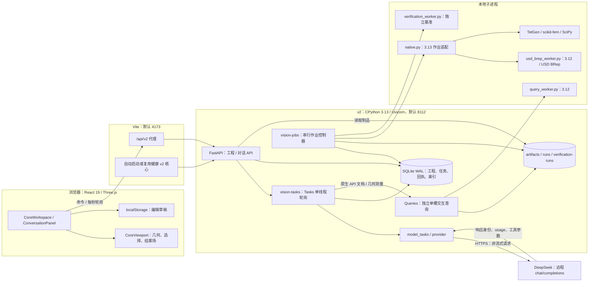

**当前启动行为：** `npm run dev` / `npm run preview` 自动启动或复用健康 v2 核心（默认 8112），只停止自身启动的进程。`VISION_CORE_PORT` 设置托管端口，`VISION_CORE_WORKSPACE` 设置工作区；显式 `VISION_CORE_URL` 连接独立服务并禁用自动启动。`scripts/start-local.ps1` 提供环境检查、依赖安装与启动入口。旧 engineering、DeepSeek 与模型状态代理已删除；v2 的 `provider.py` 直接请求固定 DeepSeek 地址。

v2 通过 Python 模块和子进程复用 `server/` 的原生能力，不经 8111 的旧 HTTP API 执行 CAD / FEA。进程隔离用于生命周期、资源管理，不是针对不可信 Python 的完整安全沙箱。

代码：[main.tsx](../src/main.tsx)、[Vite](../vite.config.ts)、[developmentBackend.ts](../scripts/developmentBackend.ts)、[v2 入口](../backend/vision/__main__.py)、[create_app](../backend/vision/api.py#L32)、[Controller](../backend/vision/jobs.py#L16)、[Queries](../backend/vision/queries.py#L28)。

## 2. 后端模块职责

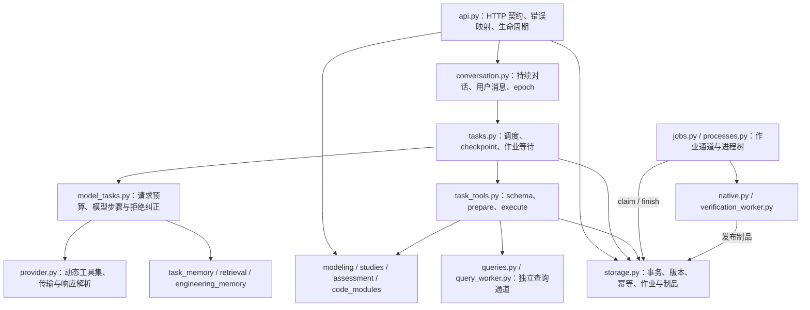

两种任务模式共享工具和 checkpoint：`explicit-local-plan/1` 按调用方提交的 plan 顺序执行，不调用 LLM；`deepseek/1` 每步由 LLM 决定工具。对话接口使用后者。当前没有 Planner、Coder、Reviewer 等独立多 Agent 实例或协商总线。

任务线程一次同步推进一个任务步骤，网络请求会占用该线程。最多 8 个活跃任务不等于 8 路并发 LLM 请求。原生作业线程独立，一次执行一个 CAD、FEA 或 verification，优先领取普通 jobs，再领取 verification。查询使用另一条单槽通道。

代码：[Tasks.loop / step](../backend/vision/tasks.py#L212)、[next_step](../backend/vision/model_tasks.py#L127)、[工具映射](../backend/vision/task_tools.py#L163)、[Controller.loop](../backend/vision/jobs.py#L46)。

## 3. 消息 → Agent → LLM → 工具完整时序

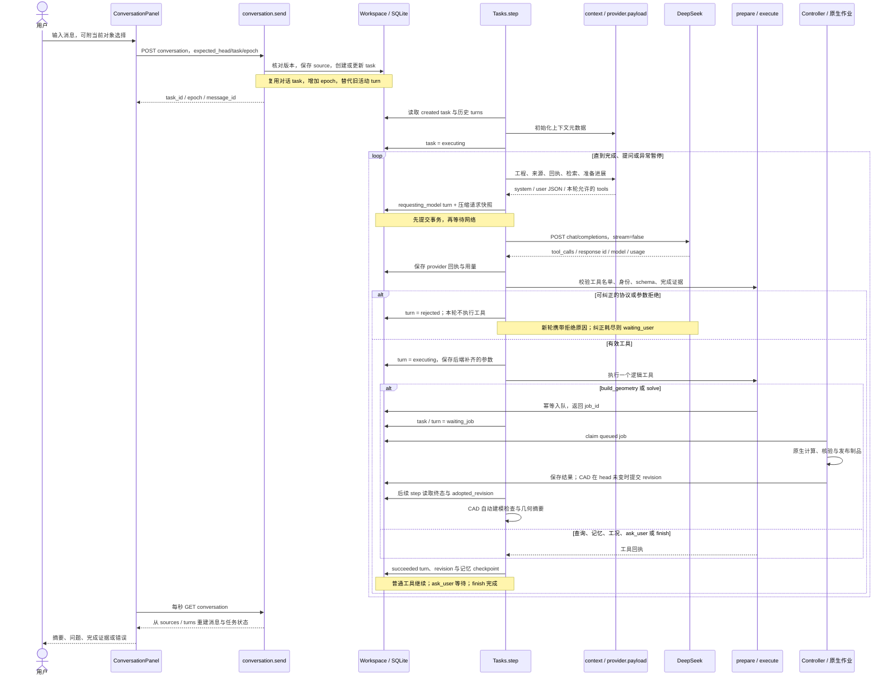

网络传输、工具执行、turn checkpoint 不是一个原子事务。写入工具依靠稳定命令 ID 与持久化命令回执防重。若在 `requesting_model` 中断，重启后转为 `waiting_user`，不自动重发可能已计费的请求；若工具已写入但 turn 尚未保存，可利用幂等回执继续对账。

代码：[conversation.send](../backend/vision/conversation.py#L44)、[Tasks.step](../backend/vision/tasks.py#L225)、[next_step](../backend/vision/model_tasks.py#L127)、[Workspace.command](../backend/vision/storage.py#L239)。

## 4. Agent / LLM 上下文数据流

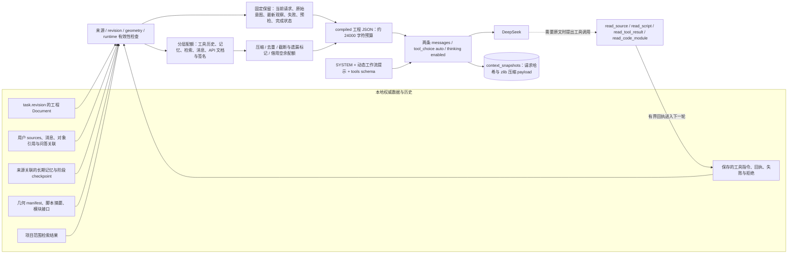

`24000` 是 compiled 工程 JSON 的字符预算，包含 planning_progress 等额外信息的预留，不是整个 prompt 的 token 数。完整请求含 system 与 schema，另有限制：序列化后不超过 `100000` 字符。UTF-8 字节数用于 token 上界估算，不是精确 tokenizer 计数。

固定/优先信息包括：最新输入、第一条原始意图、部分保留指令、当前选择是否有效、最近问题与回复、最新观察、最新失败是否已被后续成功解决、当前参数与脚本哈希、模块接口、建模要求和完成状态。近期工具组通常最多 8 组；长脚本/回执按引用展开，模块目录提供接口摘录而非全部源代码。

剩余容量按阶段分配，再借用空余额度：

| 可压缩层 | 建模 | 分析 |
|---|---:|---:|
| recent_tool_groups | 30% | 40% |
| long_term_memory | 15% | 20% |
| stage_memory | 6% | 5% |
| historical_sources | 10% | 13% |
| conversation_messages | 14% | 17% |
| cad_api_reference | 16% | 3% |
| cad_api_signatures | 9% | 2% |

LLM 可以收到用户原文、工程参数、要求、部分脚本和工具结果，并非只收到脱敏摘要。凭据单独置于 Authorization 请求头。持久化请求快照包含当轮 system、工程 JSON 与工具 schema，不含 Authorization 请求头。

代码：[context](../backend/vision/task_memory.py#L105)、[payload](../backend/vision/provider.py#L90)、[请求快照](../backend/vision/model_tasks.py#L127)、[展开工具](../backend/vision/task_tools.py#L319)。

## 5. 工具开放与建模门控

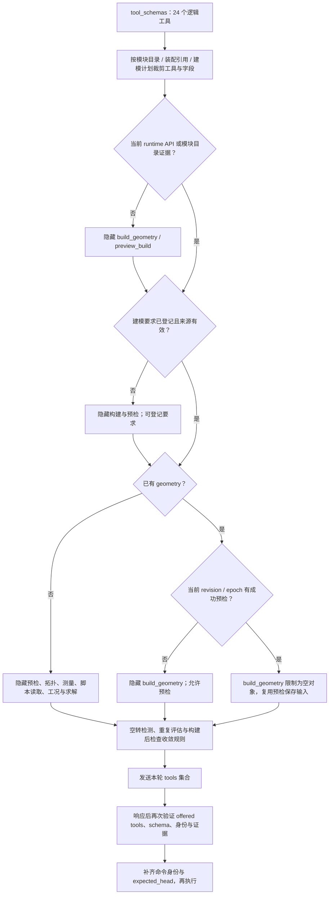

图表示过滤顺序，结果取交集，后续不会重新放回先前删除的工具。已有几何的成功预检后，进一步限制到 `build_geometry / preview_build / ask_user / finish / read_tool_result`，避免继续检查尚未改变的旧模型。

准备检测涉及：重复无新增信息的 API 查询、等价调用重复、准备步骤过多、预检过多。空转后缩减工具，让模型构建、补齐要求、读取失败或说明阻碍。构建成功且已有检查结果时建议 finish；同次构建后已有至少 2 次拓扑/测量/检查时隐藏相关追加查询。该策略控制收敛，不证明任务成功。

| 类别 | 工具 |
|---|---|
| CAD 文档与几何读取 | native_api、list_topology、inspect_geometry、read_script |
| 建模与检查 | set_modeling_requirements、preview_build、build_geometry、check_modeling |
| 模块代码 | register_code_module、search_code_modules、read_code_module、patch_code_module、read_code_assembly |
| CAE 与参考 | configure_study、solve、assessment、beam_reference、solver_validation |
| 来源与记忆 | search_sources、read_source、read_tool_result、remember |
| 交互与结束 | ask_user、finish |

`provider.parse` 通常只接受一个调用；允许将 2–4 个 `native_api` 调用合并成一次批量查询，或将 2–4 个不含点选的 `inspect_geometry` 合并成一次去重 selection 测量。其他多调用被拒绝，不能据此理解为支持并行写入工具。

代码：[payload](../backend/vision/provider.py#L90)、[parse](../backend/vision/provider.py#L253)、[planning_progress](../backend/vision/model_tasks.py#L36)、[prepare](../backend/vision/task_tools.py#L216)。

## 6. Task 状态机：对话任务

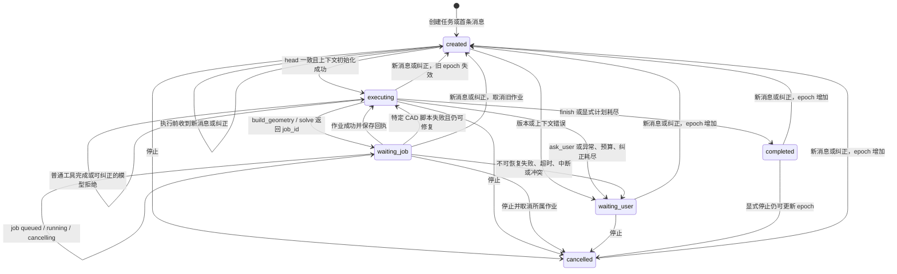

Task 没有 `failed` 状态；错误通常写入 error 并进入 waiting_user。completed / cancelled 也不是永久不可恢复：新消息可复用同一 task 并增加 epoch。纠正接口必须匹配原始模式；来源遗忘后配置为 redacted 的任务不能通过普通纠正恢复，应创建新任务。

自动脚本修复只针对特定 `CadScriptFailure`：当前 epoch 已记录的可恢复失败少于 2 次时可回到模型规划。基础设施错误、原生内核崩溃等不会一概重试。失败 Job 不复活，修复输入后提交新 Job。

代码：[Tasks](../backend/vision/tasks.py#L18)、[change](../backend/vision/tasks.py#L114)、[step](../backend/vision/tasks.py#L225)、[conversation.send](../backend/vision/conversation.py#L44)。

## 7. Turn 状态机：模型请求与工具 checkpoint

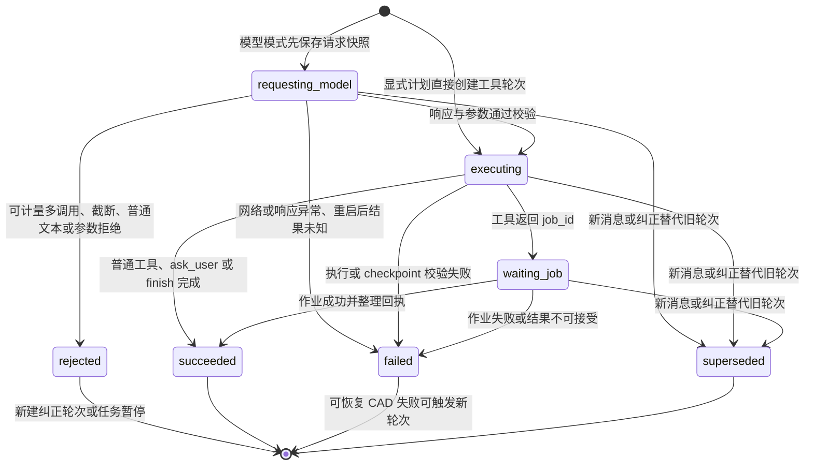

`rejected` 表示本轮未执行工具，纠正请求是新的 turn。`repair_exhausted` 检查连续拒绝：上次同类拒绝后再次同类拒绝就暂停；已有至少 2 个连续拒绝，本次再拒绝也暂停。不是所有错误统一重试三次。

遗忘来源会把受影响任务的 turns 改为 `redacted`，清空 response / arguments / receipt，这是横跨状态的清理操作。新消息/纠正与显式停止也不同：前者标记旧活动 turn 为 superseded；普通停止主要通过 task 的 epoch / cancelled 隔离旧结果，不能假设停止后所有 turn 都显示 superseded。

代码：[模型步骤](../backend/vision/model_tasks.py#L127)、[repair_exhausted](../backend/vision/model_tasks.py#L27)、[update / step](../backend/vision/tasks.py#L201)、[forget](../backend/vision/tasks.py#L145)。

## 8. Job 状态机：CAD / FEA

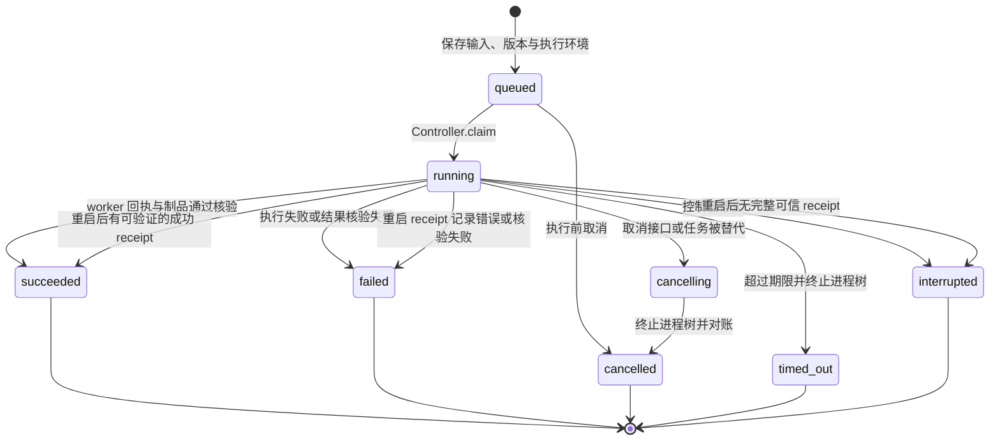

`stage` 是 job_events 中的进度事件，phase 来自最后一个 stage.detail，不是 jobs 主状态。默认 CAD 期限 240 秒，FEA 600 秒，独立 verification 900 秒；交互查询默认 15 秒，在单独通道执行。

queued 重启后仍可领取；running / cancelling 通过 `runs/<job>/receipt.json` 对账。cancelling 即使存在成功回执也最终记为 cancelled。CAD succeeded 也不保证成为当前模型：只有 head 仍等于提交 revision 才自动提交新版本并记录 adopted_revision；否则成功制品保留但不覆盖当前工程。FEA 不通过 adopted_revision 更新 head。

代码：[cancel / recover / claim / finish](../backend/vision/storage.py#L342)、[Controller.run](../backend/vision/jobs.py#L56)。

## 9. epoch、工程版本与旧结果隔离

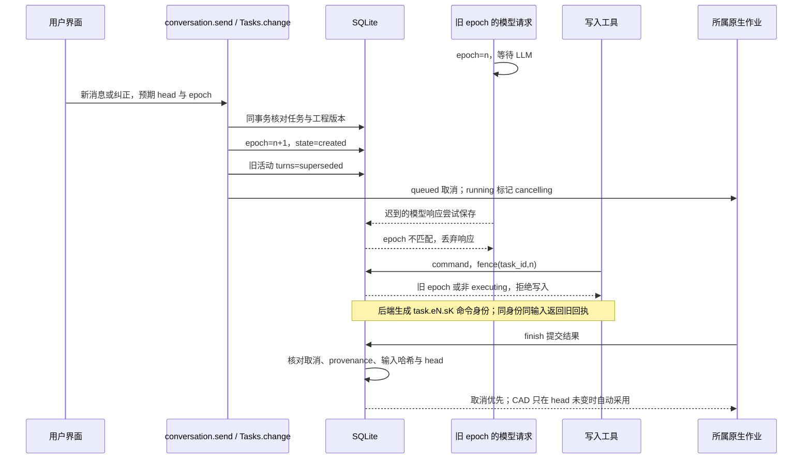

`task_id + epoch` 隔离指令世代；`expected_head` 隔离工程版本；`command_id / idempotency_key` 防止重复生效。来源可用性在请求前、工具 checkpoint 和部分制品采用阶段再次核验。

停止能让旧模型响应失效，但不保证立即终止正在等待的 HTTP 请求；任务线程可能等待响应或超时才释放。原生控制器观察 cancelling 并终止进程树。Task、写入工具与 Job 各自检查边界；Job 本身没有 epoch 列。

代码：[conversation.send](../backend/vision/conversation.py#L44)、[cancel_owned / change](../backend/vision/tasks.py#L99)、[next_step](../backend/vision/model_tasks.py#L127)、[command](../backend/vision/storage.py#L239)、[finish](../backend/vision/storage.py#L384)。

## 10. CAD / CAE 数据流与证据边界

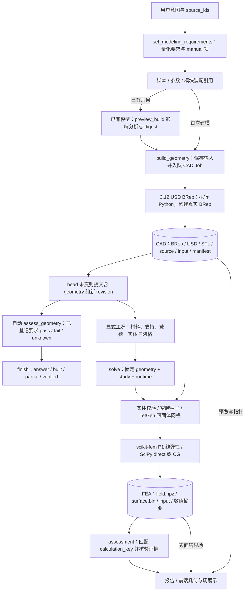

**预检不执行 Python，也不预测新拓扑。** 它列出语义对象、工况区域、实体选择和证据的失效影响，计算 digest。实际构建校验 digest；`build_geometry({})` 复用当前 epoch / revision 已保存的预检输入。

CAD 发布前检查几何结构与指标，采用时核验制品/文件哈希、提交 revision、输入 SHA-256 和制品种类。自动建模检查支持整体 bbox、实体/solid 数量和体积等指标；孔、壁厚、装配关系等 manual 项保持 unknown。`verified` 必须满足 checks_passed，仅证明已登记检查项，不证明完整形态或结构安全。

CAE 当前支持均匀各向同性线弹性静力实体。assessment 以 geometry、物理工况和 runtime 形成 calculation_key，找同输入最近作业，再核对来源、文件、收敛、残差、平衡误差、网格有效性和正应变能。几何面 ID 属于不可变制品，改变模型后需重绑；独立实体不自动粘接。

`beam_reference` 是独立解析参考；`solver_validation` 只读取当前求解器已完成基准，不启动当前零件分析。小残差不证明网格收敛；建模检查、零件 FEA、求解器基准是不同证据链。

代码：[build_impact](../backend/vision/changes.py#L8)、[native.execute](../backend/vision/native.py#L42)、[assess_geometry / completion](../backend/vision/modeling.py#L66)、[assessment](../backend/vision/assessment.py#L29)、[studies](../backend/vision/studies.py)、[fea_solver](../server/fea_solver.py)。

## 11. 代码模块与增量装配

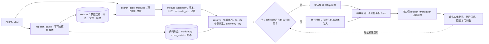

geometry_key 由代码版本、runtime、解析参数、几何依赖 key 计算，放置变换与局部几何分开。因此只移动/旋转实例可以重用局部 BRep；代码、参数或依赖几何变化会使相关组件重建。网格复用有单独条件与 module_mesh_reused 回执，不能等同于 BRep 复用。

patch_code_module 以精确唯一文本替换产生新版本；assembly_edits 基于当前指定 artifact 修改参数并保留其他定义。模块注册仅检查语法和契约，非特征验收。代码在本地 worker 执行，BRep 运行时句柄不跨进程传递。

代码：[register](../backend/vision/code_modules.py#L73)、[patch_module](../backend/vision/code_modules.py#L143)、[resolve](../backend/vision/code_modules.py#L200)、[native](../backend/vision/native.py#L42)。

## 12. 持久化关系与文件边界

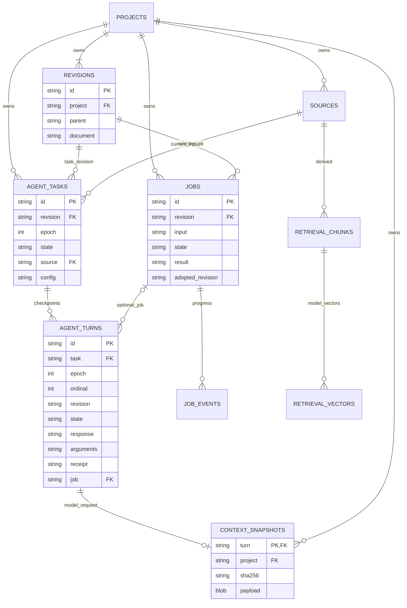

字段为选摘；document / config / input / response / arguments / receipt / result 等以 JSON 文本存储。图以 SQL 明确声明的关联为主；projects.head、revisions.parent、agent_turns.revision、jobs.adopted_revision 是代码维护的引用，不能假设都有数据库外键约束。

| 位置 | 内容与关联方式 |
|---|---|
| workspace.sqlite3 | 上图实体、命令 receipts、FTS、检索队列/状态、设置、verification_runs |
| revisions.document | geometry、study、requirements、modeling_requirements、modeling_plan、语义对象；geometry 指向制品哈希 |
| sources.payload | 用户输入、记忆、工具回执归档、模块元数据；derived_from 等 JSON 字段记录来源谱系 |
| receipts | scope + 幂等 key + command_id + 请求/响应；独立于 agent_turns.receipt |
| artifacts/<sha256>/ | 不可变 manifest 与文件，可为 CAD、FEA 或代码模块；不是 SQL 实体表 |
| runs/<job_id>/ | 作业输入、stdout/stderr、worker receipt、中间文件 |
| verification-runs/<run_id>/ | 独立求解器基准执行文件 |
| 浏览器 localStorage | 界面草稿；工程真相与任务状态以服务端为准 |

agent_turns 的 `(task,epoch,ordinal)` 唯一；receipts 在 scope 内约束 key 和 command_id。制品先发布到文件系统，再由作业事务引用，不是 SQLite 与文件系统间的分布式事务。bundles.py 负责工程导入/导出；导入的历史证据不会直接当作当前本机验证。

代码：[schema](../backend/vision/storage.py#L143)、[Artifacts](../backend/vision/storage.py#L32)、[Document](../backend/vision/contracts.py#L189)、[bundles](../backend/vision/bundles.py)、[drafts](../src/features/workspace/drafts.ts)。

## 13. 混合检索、有效性与遗忘传播

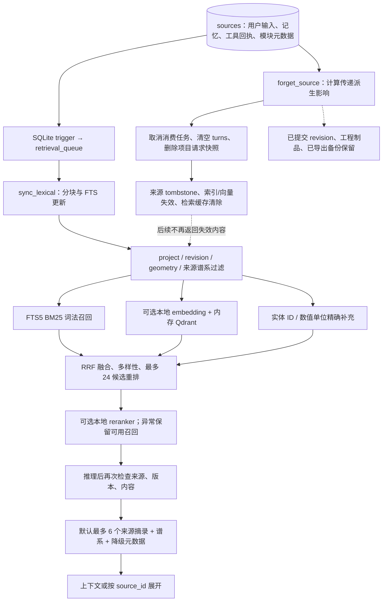

语义组件是可选本地依赖。向量由 SQLite 持久化，Qdrant 使用 `:memory:` 客户端作为可重建索引，不是远程向量服务。模型未安装、语义关闭或推理异常时降级到词法和精确匹配并报告 degraded_reason。检索命中不等于工程事实，来源需满足可用性、停用/替代、几何和版本适用性。

遗忘传播到派生来源和消费任务，并清空整个项目请求快照，避免复制文本残留。它保留已提交工程版本、工程制品和已导出的备份。工程记忆也是 sources 记录，没有独立长期记忆数据库或自动向远程 LLM 同步的记忆服务。

代码：[retrieve](../backend/vision/retrieval.py#L177)、[SemanticIndex](../backend/vision/retrieval.py#L110)、[engineering_memory](../backend/vision/engineering_memory.py)、[forget](../backend/vision/tasks.py#L145)。

## 14. Agent / LLM 限制与恢复速查

| 项目 | 当前行为 |
|---|---|
| 提供方与模型 | 固定 DeepSeek chat/completions；deepseek-flash / deepseek-v4-pro，默认 flash |
| 请求格式 | system + user JSON；stream=false；tool_choice=auto；thinking enabled |
| 思考强度 | 默认 low；具备 API 和要求证据、无预检，且复杂装配首次规划或构建失败修复时 high；截断恢复强制 low |
| 单次输出/响应体 | max_tokens=16384；响应体最多 256 KiB |
| 网络期限 | 外层 180 秒，httpx 175 秒、连接 5 秒；禁重定向、trust_env=false |
| 工程 JSON | 模型路径约 24000 字符；显式计划初始化预算 60000 字符 |
| 完整请求 | 序列化最多 100000 字符，含 system / JSON / schema |
| 受限模式 | unlimited=false 时检查 max_requests、max_jobs、600 秒和 250000 tokens 累计预算；发送前按 UTF-8 字节估算及最大输出预留 |
| 默认对话 | unlimited=true，跳过以上累计预算但保留用量；CreateModelTask 字段默认也为 true |
| 网络失败/结果未知 | 不自动重传，task 进入 waiting_user；不同于已计量的协议纠正 |
| 响应核验 | response id、精确 model、单 choice、usage 一致性、finish_reason、call id、JSON、工具名单、schema |
| 可纠正拒绝 | 已知多调用、length/stop、schema/脚本签名/完成证据错误；保存 usage，限制连续纠正 |
| 脚本修复 | 特定 CAD 脚本错误最多记录 2 次可恢复失败，再失败暂停；相同失败输入不可原样重提 |
| 写入防重 | 后端生成 task/epoch/step 命令 ID；身份复用但输入不同会冲突 |
| 重启 | 不盲目重发 requesting_model；作业靠 worker receipt 对账，工具靠幂等回执 |
| 执行边界 | Python 拥有本地用户权限，服务绑定 loopback；提示词限制不是完整执行沙箱 |

## 15. 验证与维护

本图集来自静态代码追踪，未调用远程 LLM，也未重新执行真实 CAD / FEM 数值验收。Mermaid 静态检查只覆盖工具支持的语法子集，不证明所有宿主渲染一致。

本次验证记录：13 个 Mermaid 块通过技能工具的 canonical v2 契约归一化、静态检查及 Markdown 导出检查，无警告；文档代码链接与行号均已检查。未安装本地 Mermaid 渲染器，未声称完成实际渲染验收。运行既有 `test_agent_orchestration_v2.py`（6 项）、`test_provider_response_v2.py`（5 项）、`test_post_build_verification_v2.py`（5 项），共 16 项通过；额外尝试的 `test_conversation_v2.py` 长时间未返回，已中止，不计为通过。

开发启动调整另外通过 `npm run build`、前端 11 项测试及 `scripts/test_dev_backend.mjs` 的真实本地服务回归：自动启动、v2 代理、工程持久化、关闭自有进程、复用外部进程、独立 URL 禁用托管、故障 JSON 503、拒绝不健康服务。`start-local.ps1 -CheckOnly` 在 Windows PowerShell 下验证通过；首次联网安装分支未重新执行。

可复核关键分支的既有测试：

| 行为 | 测试 |
|---|---|
| epoch、幂等、任务恢复 | tests/test_tasks_v2.py、test_model_tasks_v2.py、test_conversation_v2.py |
| 工具开放与响应协议 | tests/test_agent_orchestration_v2.py、test_provider_response_v2.py |
| 上下文与来源过滤 | tests/test_context_memory_v2.py、test_context_efficiency_v2.py、test_retrieval_focus_v2.py |
| 预检与恢复 | tests/test_preview_context_v2.py、test_modeling_recovery_v2.py、test_script_channel_v2.py |
| 完成证据 | tests/test_modeling_acceptance_v2.py、test_post_build_verification_v2.py |
| 模块与发布 | tests/test_code_modules_v2.py、test_artifact_publication_v2.py |

状态、schema、payload、上下文层、worker 或存储变更后应同步更新图示。历史 v1 的同步 HTTP、Zustand、仅浏览器聊天、前端取消不终止进程等描述不再用于概括当前 v2。相关说明：[核心代码地图](core-code-map.md)、[原生集成契约](usd-brep-integration.md)、[CAE 验证](cae-validation.md)。
